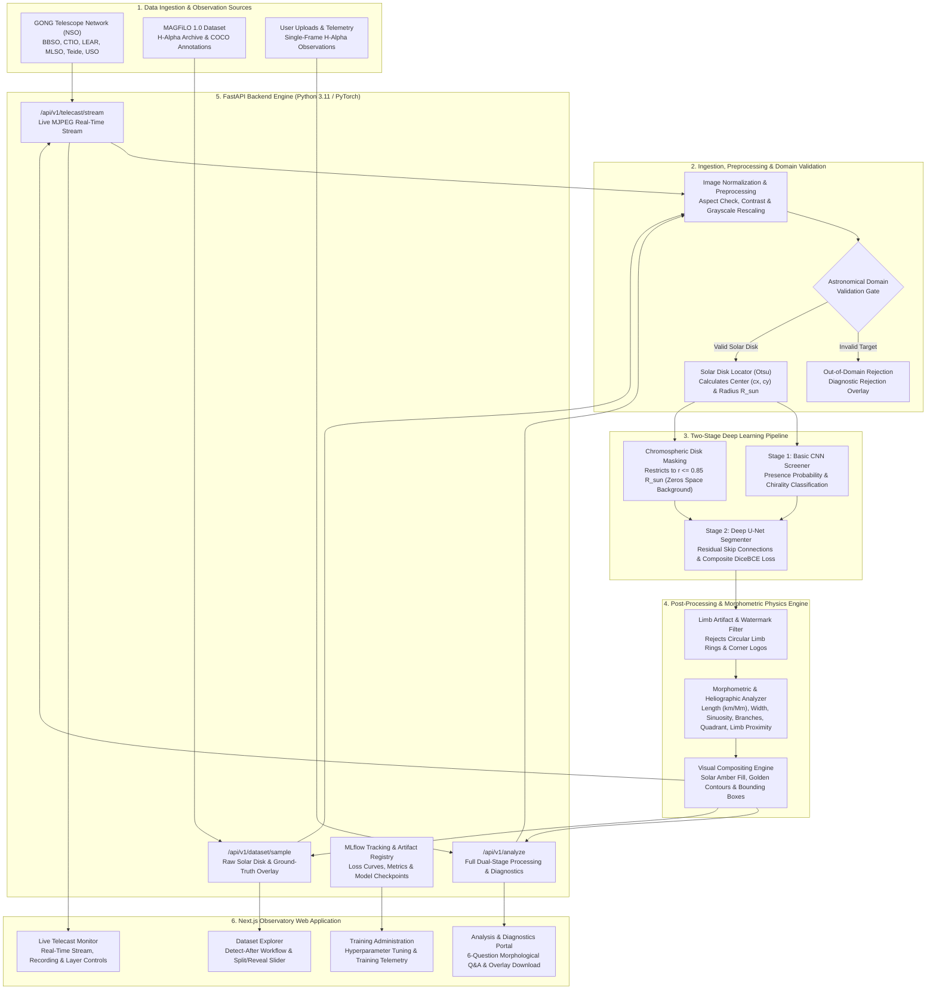

# Deep Learning Solar Filament Detection, Segmentation and Telecast Pipeline

A production-grade, two-stage deep learning pipeline and web application designed for real-time solar filament screening, pixel-accurate semantic segmentation, magnetic chirality classification, and automated observatory telecast monitoring.

The system is trained and benchmarked against the standardized MAGFiLO 1.0 dataset (Global Oscillation Network Group H-alpha observations with ground-truth polygon annotations).

---

## Executive Summary

Solar filaments are large structures of dense, cool plasma suspended in the solar corona by magnetic loops along polarity inversion lines. Because destabilization and eruption of solar filaments are principal drivers of Coronal Mass Ejections (CMEs) that disrupt satellite communications, global navigation systems, and high-voltage transmission grids, automated and low-latency detection of these structures is essential for operational space weather forecasting.

This repository provides an end-to-end framework comprising:
- A high-speed Stage 1 Convolutional Neural Network (CNN) screening filter and 4-class magnetic chirality classifier.
- A Stage 2 deep U-Net semantic segmenter optimized for severe foreground-background class imbalance using composite Dice and Binary Cross-Entropy (BCE) loss.
- An automated astronomical domain verification gate that validates H-alpha solar disk geometry and rejects out-of-domain imagery.
- A high-performance FastAPI backend service providing REST endpoints for single-image analysis and sub-40 millisecond telecast stream processing.
- A Next.js web application offering real-time stream telecasting, dataset exploration, on-demand observation analysis, and training pipeline administration.
- Integrated MLflow experiment tracking, artifact logging, and automated test suites.

---

## System Architecture



---

## Architecture and Methodology

The system implements a decoupled, two-tier hierarchical inference pipeline designed to minimize computational expenditure while maximizing detection accuracy.

### Input Calibration and Normalization
Input observations are ingested as 8-bit or 16-bit grayscale H-alpha images. The imagery is checked for valid dimensions, downsampled to standard input tensors (256 by 256 pixels), and normalized to floating-point values in the range [0.0, 1.0].

### Astronomical Domain Validation Gate
Prior to neural execution, each observation undergoes geometric and sensor validation:
1. Aspect Ratio Verification: Ensures image framing adheres to telescope field-of-view specifications (near-square 1:1 framing; rejects arbitrary photographic aspect ratios).
2. Space Background Check: Verifies that the outer perimeter surrounding the solar limb represents dark space rather than artificial indoor or white illumination.
3. Solar Disk Geometry: Uses contour segmentation and enclosing-circle fitting to verify that a circular astronomical body occupies between 30% and 95% of the frame, with an enclosing circular extent of at least 0.82 centered within 14% of the sensor center.
4. Chromospheric Texture Signature: Validates that sensor intensity variance within the disk matches solar chromospheric H-alpha physics rather than synthetic solid graphics.
Images failing validation are immediately flagged as out-of-domain targets, returning zero filament detections, zero confidence, and a diagnostic rejection notice.

### Stage 1: Fast Screening and Chirality Classification
- Architecture: 4-stage convolutional backbone with Batch Normalization, ReLU activations, and Max Pooling, followed by Adaptive Average Pooling and fully connected heads.
- Latency: Approximately 8.5 milliseconds per frame on standard CPU hardware.
- Outputs: Binary filament presence probability and 4-class magnetic twist chirality (Left-bearing, Right-bearing, Unidentifiable, Ambiguous).
- Computational Gating: If an observation is identified as a quiet solar disk (has_filament = False), downstream pixel-level segmentation can be bypassed to conserve computational throughput.

### Stage 2: U-Net Semantic Segmentation
- Architecture: Encoder-decoder U-Net network featuring Double Convolution blocks with residual skip connections across 4 resolution levels, utilizing bilinear upsampling.
- Loss Function: Composite Dice Loss combined with Binary Cross-Entropy (DiceBCELoss) with equal weighting, addressing the extreme foreground sparsity where filaments occupy less than 1% of total pixels.
- Dynamic Calibration: Incorporates adaptive probability thresholding calibrated to the active distribution within the solar disk mask, mitigating sigmoid activation compression and limb darkening edge artifacts.
- Chromospheric Absorption Fallback: Blends high-confidence U-Net predictions with black-hat morphological absorption feature extraction to guarantee robust delineation of dark plasma threads.

### Morphometric and Heliographic Physics Engine
The pipeline analyzes every segmented structure in calibrated physical units ($R_{\odot} = 696,340\text{ km}$):
1. Spine Length: Calibrated physical length in pixels, kilometers, and Megameters ($1\text{ Mm} = 10^3\text{ km}$) using hydraulic ribbon geometry ($L = \frac{P + \sqrt{P^2 - 16A}}{4}$) and minimum oriented bounding box major axis.
2. Cross-Sectional Width: Mean spine thickness ($W = A / L$) and elongation aspect ratio ($L / W$).
3. Curvature & Sinuosity: Evaluates sinuosity index ($S = L_{\text{spine}} / D_{\text{endpoints}}$) and convex hull solidity to categorize structures into Straight, Curved, or Fragmented.
4. Spine Branching: Identifies lateral barbs and dendritic magnetic bifurcations (single continuous spine vs. multi-branch structure).
5. Heliographic Positioning: Maps filament centroid to solar quadrants (NE, NW, SE, SW, Central Disk) and solar latitude belts (Equatorial Belt, Mid-Latitudes, Polar Crown) with radial offset ratio ($r / R_{\odot}$).
6. Solar Limb Proximity: Flags structures near the solar limb ($r / R_{\odot} \ge 0.70$) subject to line-of-sight foreshortening versus intermediate or central disk features.

### Vector Geometry and Visual Compositing
- Connected Components: Extracts individual discrete filament contours via border-following algorithms.
- Polygon Approximations: Applies the Douglas-Peucker algorithm to compute lossless COCO-compliant polygon coordinates and bounding boxes.
- Area Metrics: Computes calibrated pixel area and percentage coverage relative to the solar disk. Flags elevated solar activity when total filament area exceeds 1,000 pixels.
- Visual Compositing: Renders clean, high-contrast astronomical highlights (warm Solar Amber fill, sharp golden boundary contours, indexed filament tags, golden bounding boxes, and integrated HUD metrics).

---

## Web Application and User Interface

The frontend is implemented in Next.js with React and TypeScript, delivering an observatory workspace structured into four functional modules:

1. Live Monitor: Continuous telescope stream viewer displaying real-time processed frames, live HUD filament detection badges, telecast control toggles, and station telemetry.
2. Dataset Explorer: Interactive browser for the MAGFiLO 1.0 archive, presenting dataset statistics, chirality distribution metrics, and randomized ground-truth sample overlays with spring-green annotations.
3. Analysis and Segmentation: On-demand upload portal enabling manual inspection of high-resolution H-alpha observations, dynamic detection threshold adjustment (0.10 to 0.90), dual-stage metric readouts, and visual segmentation previews with out-of-domain rejection banners.
4. Training and Pipelines: Administrative interface for monitoring training sessions, configuring hyperparameters (epochs, batch size, sample count), tracking validation loss curves, and reviewing model registry artifacts.

---

## REST API Specification

The FastAPI backend exposes the following REST endpoints:

- GET /health
  Returns service status, hardware accelerator (CPU or CUDA), and Stage 1 / Stage 2 model readiness indicators.

- POST /api/v1/detect
  Accepts a multipart image upload. Executes Stage 1 CNN screening to determine filament presence and dominant magnetic chirality.

- POST /api/v1/segment
  Accepts a multipart image upload and optional threshold parameter. Executes Stage 2 U-Net segmentation, returning discrete filament polygons, bounding boxes, total area, and binary masks.

- POST /api/v1/analyze
  Executes the complete pipeline: domain validation, Stage 1 CNN screening, Stage 2 U-Net segmentation, and annotated Base64 visual overlay generation.

- POST /api/v1/telecast/process-frame
  High-throughput endpoint optimized for real-time camera stream frames (under 40 ms latency), returning detection counts and space weather activity flags.

- GET /api/v1/telecast/sample-frame
  Supplies ground-truth test frames encoded in Base64 for stream simulation and testing.

- GET /api/v1/dataset/stats
  Returns MAGFiLO 1.0 dataset metadata, total image counts across splits, and class distributions.

- GET /api/v1/dataset/sample
  Retrieves a random dataset observation rendered with ground-truth polygon overlays.

- POST /api/v1/train/start
  Dispatches an asynchronous fine-tuning routine for the CNN, U-Net, or both models.

- GET /api/v1/train/status
  Queries the live status, progress percentage, epoch progression, and loss metrics of active training jobs.

---

## Experiment Tracking with MLflow

The training workflow integrates with MLflow for experiment reproducibility:
- Parameters: Logged parameters include learning rate, batch size, target image resolution, and epoch count.
- Metrics: Per-epoch validation loss, Dice coefficient, Intersection over Union (IoU), Precision, Recall, and Pixel Accuracy.
- Artifacts: Checkpoint state dictionaries (.pth), model architecture representations, and environment configurations logged directly to the artifact repository.

To launch the MLflow web interface:
```bash
mlflow ui --backend-store-uri sqlite:///mlflow.db --port 5000
```
The tracking dashboard will be accessible at http://localhost:5000.

---

## Automated Verification and Testing

The repository provides a comprehensive automated test suite verifying system integrity across:
- Input Robustness: Ingestion of zero-byte files, corrupted payloads, non-image files, invalid thresholds, and malformed Base64 frames.
- Domain Validation: Out-of-domain rejection testing on natural imagery, portrait photos, uniform graphics, and non-circular shapes.
- API Schema Integrity: Validation of response contracts for all REST endpoints against Pydantic schemas.
- Mathematical Invariants: Verification of probability bounding in [0.0, 1.0], softmax categorical normalization, and non-negative geometric area constraints.

To execute the test suite:
```bash
python -m unittest backend/tests/test_ml.py
python -m unittest backend/tests/test_api.py
```

---

## Deployment and Execution Guide

### Prerequisites
- Python 3.11 or higher
- Node.js 18 or higher and pnpm package manager
- PyTorch 2.0 or higher (CPU or CUDA enabled)
- OpenCV (headless or standard)

### Backend Service Setup
```bash
# Clone the repository
git clone https://github.com/Vaibhav-S-Gowda/Deep-Learning-Solar-Filament-Detection-Segmentation-Telecast-Pipeline.git
cd Deep-Learning-Solar-Filament-Detection-Segmentation-Telecast-Pipeline

# Create and activate virtual environment
python -m venv venv
source venv/bin/activate  # On Windows: venv\Scripts\activate

# Install dependencies
pip install -r requirements.txt

# Start FastAPI application
python -m uvicorn backend.main:app --host 0.0.0.0 --port 8000 --reload
```
The API documentation will be available at http://localhost:8000/docs.

### Frontend Application Setup
```bash
# Navigate to the frontend directory
cd frontend

# Install dependencies
pnpm install

# Start Next.js development server
pnpm run dev
```
The web dashboard will be accessible at http://localhost:3000.

### Containerized Deployment with Docker Compose
A multi-service configuration is provided to launch the API and MLflow tracking server concurrently:
```bash
docker-compose up --build -d
```
Service ports:
- API Gateway and OpenAPI Documentation: http://localhost:8000
- MLflow Experiment Server: http://localhost:5000

---

## Performance Benchmarks

Inference performance evaluated on standard x86-64 hardware across varying batch sizes:

| Model Architecture | Batch Size | Total Batch Latency | Per-Observation Latency | Throughput | Peak Resident Memory |
| :--- | :---: | :---: | :---: | :---: | :---: |
| FilamentBasicCNN | 1 | 8.56 ms | 8.56 ms | 116.8 FPS | 253.1 MB |
| FilamentBasicCNN | 4 | 35.90 ms | 8.98 ms | 111.4 FPS | 336.7 MB |
| FilamentBasicCNN | 16 | 171.36 ms | 10.71 ms | 93.4 FPS | 479.5 MB |
| SolarFilamentUNet | 1 | 64.42 ms | 64.42 ms | 15.5 FPS | 330.2 MB |
| SolarFilamentUNet | 4 | 299.72 ms | 74.93 ms | 13.3 FPS | 538.8 MB |
| SolarFilamentUNet | 16 | 1267.77 ms | 79.24 ms | 12.6 FPS | 1376.8 MB |

---

## License and Attribution

This project is licensed under the MIT License. Ground-truth solar imagery is derived from the Global Oscillation Network Group (GONG) H-alpha network operated by the National Solar Observatory (NSO).
